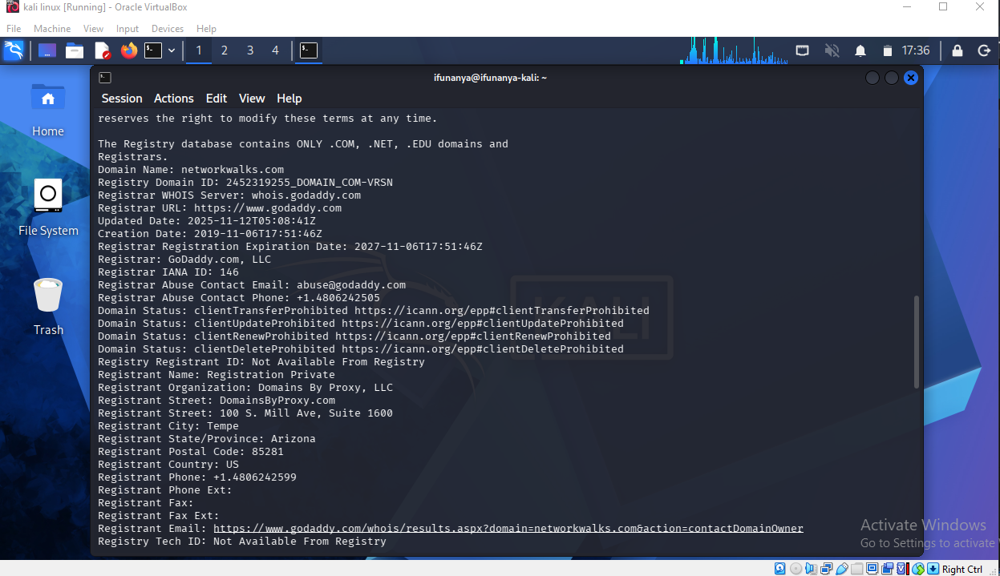
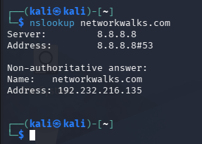
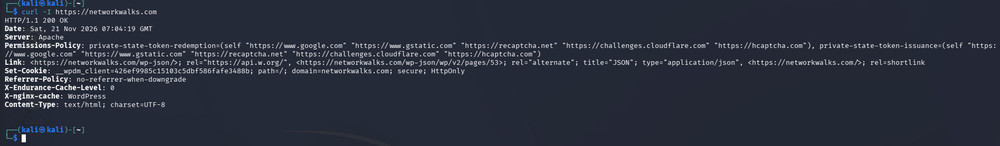
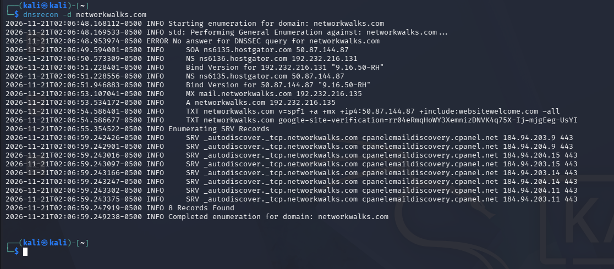
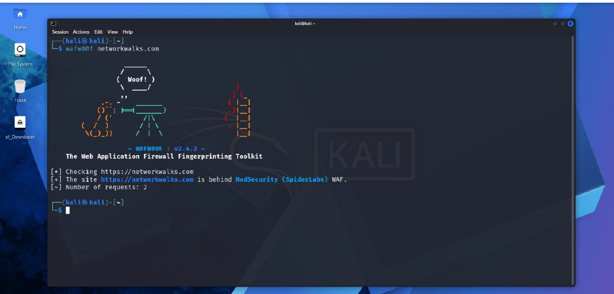
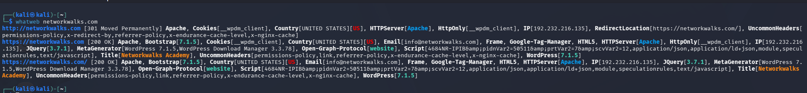
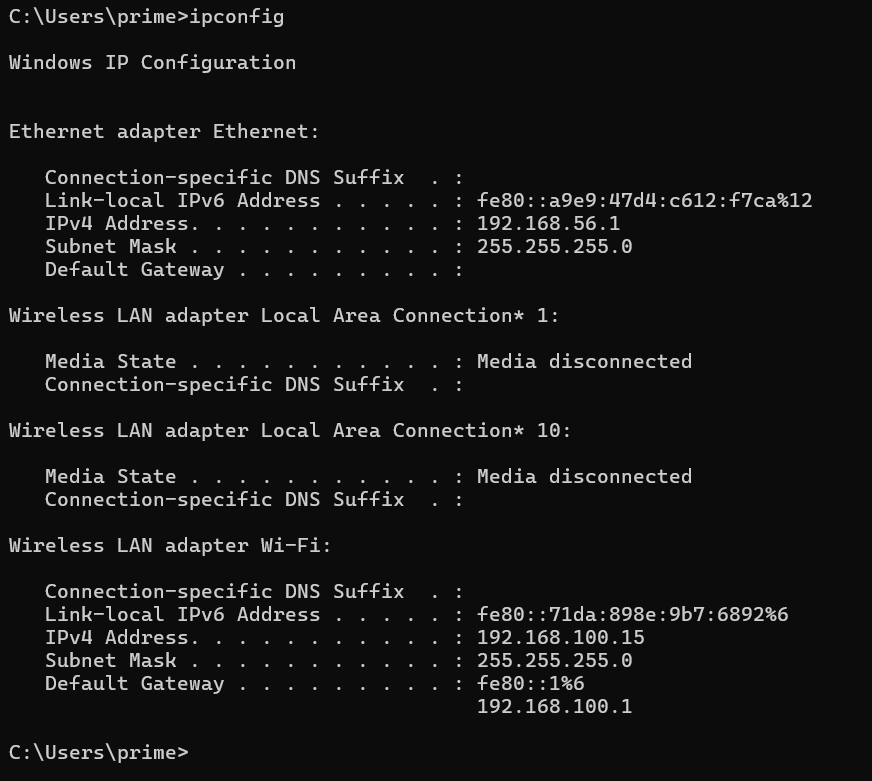

<h1 align="center">NETWORKWALKS-B084C WK2-PM1-FOOTPRINTING, RECONNAISSANCE AND NETWORK SCANNING</h1>

<h2 align="center">Footprinting, Reconnaissance and Network Scanning</h2>

<strong>Internship programme:</strong> Networkwalks cybersecurity internship 
<strong>Internship batch:</strong> B084C 
<strong>Week:</strong> 02 
<strong>Session:</strong> PM1 
<strong>Additional Tools:</strong> Windows Command Prompt, Nmap and Zenmap 
<strong>Operating System:</strong> Kali Linux

<h2>Introduction</h2>

This report covers footprinting the <code>networkwalks.com</code> domain using multiple Kali Linux tools and scanning my own local network with Zenmap. One module covers the footprinting phase and the other covers the scanning phase, so together they show how an attacker moves from gathering public information to mapping live hosts on a network. It is the Week 2 part of my ongoing internship program at Networkwalks.

All commands were run in Kali Linux (footprinting) and on a Windows PC with Zenmap installed (scanning). Every step below includes the exact command used, the result I observed, a screenshot as evidence, and a short note on why the finding matters from an attacker's point of view.

The exercises provided practical experience with reconnaissance tools and helped me understand how information about web infrastructure and network devices can be collected and interpreted during a security assessment.

<h1>Part 1: Footprinting &amp; Reconnaissance</h1>

<h2>1. WHOIS: Domain Registration Information</h2>

I started by retrieving the registration information associated with <code>networkwalks.com</code> using WHOIS.

<strong>Command:</strong>

<pre><code>whois networkwalks.com</code></pre>

<h3>Results</h3>

The lookup returned the following information:

<table>
  <thead>
    <tr><th>Information</th><th>Result</th></tr>
  </thead>
  <tbody>
    <tr><td>Domain</td><td>networkwalks.com</td></tr>
    <tr><td>Registrar</td><td>GoDaddy.com, LLC</td></tr>
    <tr><td>Creation Date</td><td>6 November 2019</td></tr>
    <tr><td>Updated Date</td><td>12 November 2025</td></tr>
    <tr><td>Expiry Date</td><td>6 November 2027</td></tr>
    <tr><td>Name Server 1</td><td>ns6135.hostgator.com</td></tr>
    <tr><td>Name Server 2</td><td>ns6136.hostgator.com</td></tr>
  </tbody>
</table>

The domain registration record also displayed several domain status codes, including <code>clientTransferProhibited</code> and <code>clientUpdateProhibited</code>.

<h3>Analysis</h3>

The WHOIS results identified GoDaddy as the registrar and HostGator as the provider associated with the domain's name servers. The registration dates and domain status codes provided additional information about the domain's registration and management.

<h2>2. NSLOOKUP: DNS Resolution</h2>

I used NSLookup to determine the IP address associated with the domain and identify the DNS resolver responding to the request.

<strong>Command:</strong>

<pre><code>nslookup networkwalks.com</code></pre>

<h3>Results</h3>

<table>
  <thead>
    <tr><th>Information</th><th>Result</th></tr>
  </thead>
  <tbody>
    <tr><td>DNS Server</td><td>8.8.8.8</td></tr>
    <tr><td>DNS Port</td><td>53</td></tr>
    <tr><td>Domain</td><td>networkwalks.com</td></tr>
    <tr><td>Resolved IPv4</td><td>192.232.216.135</td></tr>
  </tbody>
</table>

The response was identified as non-authoritative, meaning the answer was returned by a DNS resolver rather than directly by the domain's authoritative name server.

<h3>Analysis</h3>

The lookup successfully resolved <code>networkwalks.com</code> to <code>192.232.216.135</code>. This IP address was subsequently useful when examining the website's HTTP responses and associated technologies.

<h2>3. cURL: HTTP Response Header Inspection</h2>

I used cURL to inspect the HTTP response headers returned by the website.

<strong>Command:</strong>

<pre><code>curl -I https://networkwalks.com</code></pre>

<h3>Results</h3>

The request returned an <code>HTTP/1 200</code> response, indicating that the server successfully processed the request.

Other information observed included:

<ul>
  <li>Web server: Apache</li>
  <li>Content type: <code>text/html; charset=UTF-8</code></li>
  <li>WordPress-related API endpoint information</li>
  <li>Cookie security attributes: Secure and HttpOnly</li>
  <li>Referrer policy: <code>no-referrer-when-downgrade</code></li>
  <li>Permissions policy header</li>
</ul>

<h3>Analysis</h3>

The response headers provided information about the website's server configuration and how it communicates with clients. The Secure and HttpOnly cookie attributes were also visible in the response.

This inspection helped me understand how HTTP headers can reveal useful details about a web application's configuration without requiring access to its backend.

<h2>4. DNSRecon: DNS Enumeration</h2>

I used DNSRecon to collect additional DNS records associated with the domain.

<strong>Command:</strong>

<pre><code>dnsrecon -d networkwalks.com</code></pre>

<h3>Results</h3>

The enumeration returned eight records and identified several DNS record types.

<h4>A Record</h4>
<pre><code>networkwalks.com
192.232.216.135</code></pre>

<h4>NS Records</h4>
<pre><code>ns6135.hostgator.com
ns6136.hostgator.com</code></pre>

<h4>MX Record</h4>
<pre><code>mail.networkwalks.com
192.232.216.135</code></pre>

<h4>SOA Record</h4>

The tool identified the domain's Start of Authority record.

<h4>TXT Records</h4>

The output included a Google site verification record and an SPF policy:

<pre><code>v=spf1 +a +mx +ip4:50.87.144.87 +include:websitewelcome.com ~all</code></pre>

<h4>SRV Records</h4>

The enumeration also identified service records associated with cPanel email autodiscovery.

The DNSSEC query did not return an answer.

<h3>Analysis</h3>

DNSRecon provided more detailed information than the initial NSLookup query. It revealed the domain's name servers, mail configuration, TXT records and service records.

The findings showed how DNS enumeration can expose information about the different services associated with a domain.

<h2>5. WAFW00F: Web Application Firewall Detection</h2>

I used WAFW00F to determine whether a Web Application Firewall was detectable on the website.

<strong>Command:</strong>

<pre><code>wafw00f networkwalks.com</code></pre>

<h3>Results</h3>

The tool returned:

<blockquote>The site https://networkwalks.com is behind ModSecurity (SpiderLabs) WAF.</blockquote>

The detection process completed after two requests.

<h3>Analysis</h3>

The result identified ModSecurity (SpiderLabs) as the detected Web Application Firewall.

ModSecurity is used to inspect HTTP traffic and apply security rules against potentially malicious requests.

Identifying the WAF provided information about one of the security technologies protecting the website's web traffic.

<h2>6. WhatWeb: Website Technology Fingerprinting</h2>

I used WhatWeb to identify technologies and software associated with the website.

<strong>Command:</strong>

<pre><code>whatweb networkwalks.com</code></pre>

<h3>Results</h3>

The scan identified the following technologies:

<table>
  <thead>
    <tr><th>Technology</th><th>Detected Information</th></tr>
  </thead>
  <tbody>
    <tr><td>Web Server</td><td>Apache</td></tr>
    <tr><td>CMS</td><td>WordPress</td></tr>
    <tr><td>WordPress</td><td>7.1.4</td></tr>
    <tr><td>Bootstrap</td><td>7.1.4</td></tr>
    <tr><td>jQuery</td><td>3.7.1</td></tr>
    <tr><td>JavaScript</td><td>HTML5 and JavaScript</td></tr>
    <tr><td>Other Components</td><td>Google Tag Manager, WordPress Download Manager</td></tr>
  </tbody>
</table>

The tool also identified an HTTP redirect to the HTTPS version of the website.

<h3>Analysis</h3>

The results showed that the website uses WordPress and several supporting web technologies.

This information is relevant to security assessments because identifying the software components of a website helps determine which technologies may require further security review.

However, technology identification alone does not confirm the existence of a vulnerability.

<h2>7. Part 1 Findings Summary</h2>

The footprinting and reconnaissance activities produced the following findings:

<table>
  <thead>
    <tr><th>Tool</th><th>Purpose</th><th>Main Finding</th></tr>
  </thead>
  <tbody>
    <tr><td>WHOIS</td><td>Registration lookup</td><td>GoDaddy registrar</td></tr>
    <tr><td>NSLookup</td><td>DNS resolution</td><td>192.232.216.135</td></tr>
    <tr><td>cURL</td><td>HTTP inspection</td><td>HTTP/1 200, Apache</td></tr>
    <tr><td>DNSRecon</td><td>DNS enumeration</td><td>Eight records found</td></tr>
    <tr><td>WAFW00F</td><td>WAF detection</td><td>ModSecurity</td></tr>
    <tr><td>WhatWeb</td><td>Technology identification</td><td>WordPress, Apache, jQuery</td></tr>
  </tbody>
</table>

The combined results provided information about the domain's registration, DNS infrastructure, web technologies, HTTP configuration and detected security controls.

<h1>Part 2: Network Scanning Using Nmap and Zenmap</h1>

<h2>1. Identifying the Local Network Configuration</h2>

Before scanning the network, I used the Windows Command Prompt to identify the IP address and subnet configuration of my computer.

<strong>Command:</strong>

<pre><code>ipconfig</code></pre>

<h3>Results</h3>

The Wireless LAN adapter displayed the following configuration:

<table>
  <thead>
    <tr><th>Network Information</th><th>Value</th></tr>
  </thead>
  <tbody>
    <tr><td>IPv4 Address</td><td>172.20.10.10</td></tr>
    <tr><td>Subnet Mask</td><td>255.255.255.240</td></tr>
    <tr><td>Default Gateway</td><td>172.20.10.1</td></tr>
    <tr><td>Network Address</td><td>172.20.10.0/28</td></tr>
  </tbody>
</table>

The subnet mask <code>255.255.255.240</code> corresponds to a <code>/28</code> network containing 16 total IP addresses, with 14 usable host addresses.

<h2>2. Configuring the Nmap Scan in Zenmap</h2>

After identifying the network range, I launched Zenmap to perform host discovery.

I entered the target network:

<pre><code>172.20.10.0/28</code></pre>

I selected the Ping Scan profile.

The command generated by Zenmap was:

<pre><code>nmap -sn 172.20.10.0/28</code></pre>

The <code>-sn</code> option performs host discovery without conducting a port scan.

<h2>3. Discovering Active Hosts</h2>

After executing the scan, Nmap examined the specified network range and identified four active hosts.

<h3>Scan Results</h3>

<table>
  <thead>
    <tr><th>S/N</th><th>IP Address</th><th>Status</th></tr>
  </thead>
  <tbody>
    <tr><td>1</td><td>172.20.10.1</td><td>Host Up</td></tr>
    <tr><td>2</td><td>172.20.10.7</td><td>Host Up</td></tr>
    <tr><td>3</td><td>172.20.10.10</td><td>Host Up</td></tr>
    <tr><td>4</td><td>172.20.10.11</td><td>Host Up</td></tr>
  </tbody>
</table>

The scan summary displayed:

<pre><code>16 IP addresses scanned
4 hosts up</code></pre>

<h2>4. MAC Address Identification</h2>

The scan output also displayed MAC address information for some discovered hosts.

One of the devices was identified with the following manufacturer information:

<table>
  <thead>
    <tr><th>Information</th><th>Result</th></tr>
  </thead>
  <tbody>
    <tr><td>IP Address</td><td>172.20.10.11</td></tr>
    <tr><td>Manufacturer</td><td>Liteon Technology</td></tr>
  </tbody>
</table>

MAC address information can help identify network devices and distinguish individual interfaces on a local network.

The captured output did not provide sufficiently clear MAC details for every host, so only the readable manufacturer information has been documented.

<h2>5. Network Scan Summary</h2>

The completed scan produced the following results:

<table>
  <thead>
    <tr><th>Description</th><th>Result</th></tr>
  </thead>
  <tbody>
    <tr><td>Target Network</td><td>172.20.10.0/28</td></tr>
    <tr><td>Total IP Addresses Scanned</td><td>16</td></tr>
    <tr><td>Active Hosts</td><td>4</td></tr>
    <tr><td>Scan Type</td><td>Ping Scan</td></tr>
    <tr><td>Nmap Option</td><td>-sn</td></tr>
    <tr><td>Scan Duration</td><td>4.15 seconds</td></tr>
  </tbody>
</table>

The four responding IP addresses were <code>172.20.10.1</code>, <code>172.20.10.7</code>, <code>172.20.10.10</code> and <code>172.20.10.11</code>.

The address <code>172.20.10.10</code> belonged to the computer from which the network configuration was obtained, while <code>172.20.10.1</code> was identified as the default gateway.

<h2>6. Network Topology</h2>

The scan identified four active IP addresses within the <code>172.20.10.0/28</code> network.

The discovered network addresses were:

<ul>
  <li>172.20.10.1</li>
  <li>172.20.10.7</li>
  <li>172.20.10.10</li>
  <li>172.20.10.11</li>
</ul>

These results provided a basic view of the active devices within the scanned subnet.

<h2>7. Analysis and Security Implications</h2>

The scan demonstrated how Nmap can identify devices responding within a specified network range.

The discovery of four active hosts provides a starting point for network inventory and further assessment.

In a real network environment, this information can help administrators identify connected devices, investigate unfamiliar hosts and maintain an accurate record of network assets.

The scan was limited to host discovery. It did not establish which ports were open or which services were running on the discovered devices. Those would require additional authorized scanning.

<h1>Conclusion</h1>

This practical covered two important areas of cybersecurity reconnaissance: website footprinting and network host discovery.

In Part 1, I used six Kali Linux tools to investigate <code>networkwalks.com</code>. I retrieved domain registration information, resolved its IP address, inspected HTTP response headers, enumerated DNS records, identified its web technologies and detected ModSecurity as its Web Application Firewall.

In Part 2, I used Windows Command Prompt to identify my local network configuration and Zenmap to scan the <code>172.20.10.0/28</code> subnet. The scan examined 16 IP addresses and identified four active hosts.

The practical strengthened my ability to use reconnaissance tools, interpret their output and document technical findings. It also gave me a clearer understanding of how domain investigation and network discovery contribute to the initial stages of a cybersecurity assessment.

<h2>Author</h2>

<strong>Name:</strong> Dileep Kumar  
  
<strong>LinkedIn:</strong> <a href="https://www.linkedin.com/in/ifunanya-promise-adinde-95354140a">linkedin.com/in/ifunanya-promise-adinde-95354140a</a>

